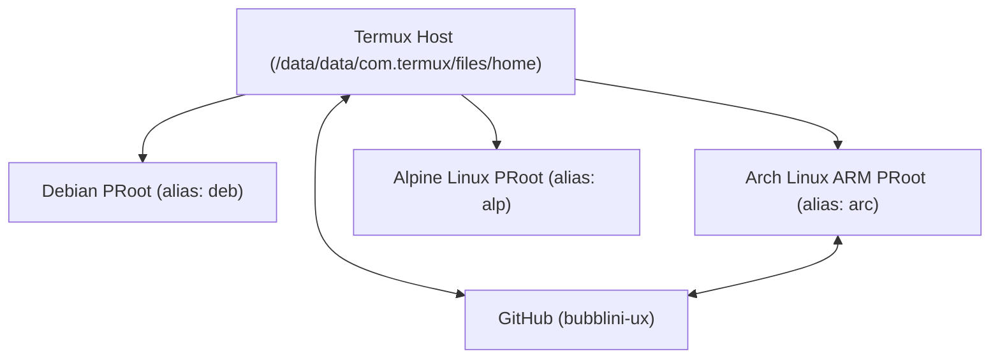

# Workspace & Repository Architecture (`ARCHITECTURE.md`)

## 1. Environment Topology

The development environment runs on an Android/Linux host using **Termux** as the primary hypervisor/shell and **`proot-distro`** for isolated Linux root filesystems:

### Host & Container Roles
1. **Termux Host (`$HOME`)**:
   - Primary Git & GitHub CLI (`gh`) control plane.
   - Hosts `~/DOCS` (this repository), `~/today-i-learned` (Jekyll blog), `~/gh/repo/*` (canonical repository mirrors), and `~/.local/bin/agy` (Antigravity CLI).
2. **Debian Container (`deb`)**:
   - Dedicated Debian userland with `agy` (`v1.5.3`) installed at `/root/.local/bin/agy` and configured with system `ca-certificates` + synced OAuth credentials.
3. **Arch Linux ARM Container (`arc`)**:
   - Hosts `/root/.local/bin/claude`, `/root/dotfiles`, `/root/daily`, `/root/personas`, and domain-specific training workspaces (`/root/rust-engineer`, `/root/security-officer-training`, `/root/stunt-man-training`, `/root/motorcycle-mechanics-school`).
4. **Alpine Container (`alp`)**:
   - Lightweight container for minimal tooling and isolated testing.

---

## 2. Repository Layout (`~/DOCS`)

| File | Purpose |
| :--- | :--- |
| `README.md` | Entry point, index of documentation, and quick maintenance commands. |
| `FINDINGS.md` | Point-in-time audit of all local and remote `bubblini-ux` repositories and containers. |
| `TODOS.md` | Actionable checklist and agent directives across repositories. |
| `ARCHITECTURE.md` | High-level overview of the Termux/PRoot system and repository structure. |
| `ROADMAP.md` | Milestones for repository consolidation, CI/CD, and project deliverables. |
| `billing.md` | Reference documentation for GitHub Codespaces compute and storage billing. |
| `prebuilds.md` | Reference documentation for GitHub Codespaces prebuild workflows. |
| `SECURITY.md` | Secret management rules and pre-commit verification checks. |
| `CONTRIBUTING.md` | Pull request workflow for protected branches. |
| `CHANGELOG.md` | Versioned history of repository changes. |
